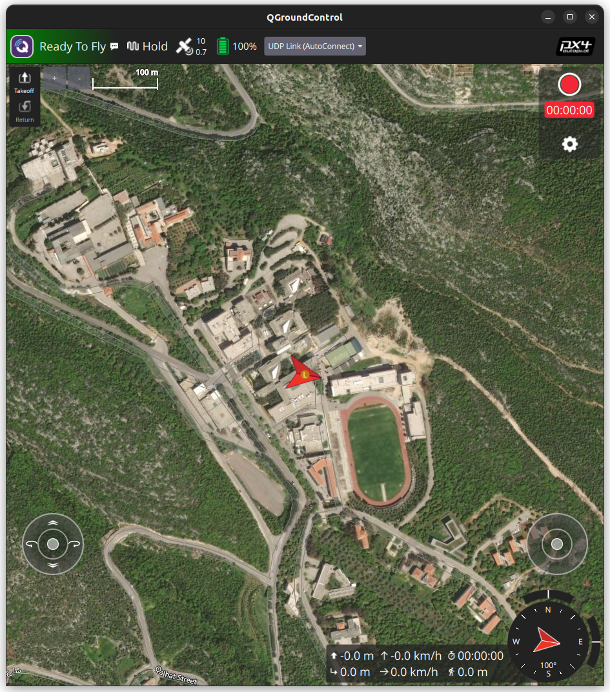

# UOB SkyDrop

**Autonomous campus delivery drone: simulation and flight software for a University of Balamand senior design project.**

SkyDrop is a quadcopter built on the Holybro X650 frame that carries small packages (up to 1 kg) between buildings on the University of Balamand campus. It flies a GPS route, avoids obstacles with a depth camera, lands on a marked pad, checks the recipient's QR code, and releases the package. All flight software is developed and tested in simulation (PX4 SITL + Gazebo) before it runs on the real drone.



*The simulated X650 connected to QGroundControl at its UOB home position, ready to fly.*

## Status

As of 30 Oct 2026, the simulated X650 flies in Gazebo with a dedicated PX4 airframe, and Phase 3 (scripted flight) is next.

| Phase | Work | Status |
| --- | --- | --- |
| 0–2 | PX4 + Gazebo + QGroundControl, manual flight | Done |
| – | X650 model, airframe config, launch script | Done and verified |
| 3 | Scripted flight with MAVSDK-Python | Scripts written, next to run on the X650 model |
| 4 | ROS 2 and the PX4 bridge (Jetson software) | Planned |
| 5 | Depth camera (RealSense D455) and obstacle avoidance | Planned |
| 6 | Precision landing on ArUco/QR markers | Planned |
| 7 | Gripper, package and Jetson weight on the model | Planned |
| 8 | Real UOB campus world and geofence | Planned |
| 9 | Full delivery mission and failure tests | Planned |
| 10 | Hardware-in-the-loop, then the real drone | Planned |

Details: [progress record](docs/progress-record.md) · [roadmap](docs/roadmap.md)

## The simulated drone

| Property | Value |
| --- | --- |
| Frame | X650, 650 mm wheelbase, rotors at ±0.2298 m on each axis |
| Mass | 3.226 kg: frame and electronics 1.912 kg, 6S 10000 mAh battery 1.226 kg, 4 × 0.022 kg propellers |
| Propulsion | Max 628.3 rad/s, motor constant 4.83e-05; hover at 404.7 rad/s, so hover throttle 0.644 |
| Sensors | IMU 250 Hz, barometer 50 Hz, magnetometer 100 Hz, GPS 30 Hz, with realistic noise |
| Not on the model yet | Jetson, depth camera, gripper, package (added in Phases 4–7) |
| World | `uob_training`: placeholder campus at 34.36628 N, 35.78218 E, 262 m |

## Repository layout

```
uob-skydrop/
├── simulation/
│   ├── models/          Gazebo models: X650 (x650_skydrop_v2 + _v2_base), meshes, campus
│   ├── worlds/          uob_training.sdf (campus), uob.sdf (flat test field)
│   ├── airframes/       22001_gz_x650_skydrop, the PX4 airframe for the X650
│   ├── install.sh       copies the above into PX4 and registers the airframe
│   ├── sync_from_px4.sh copies edits made inside PX4 back into this repo
│   └── run_x650_v2.sh   launches PX4 + Gazebo (one window, clean shutdown)
├── scripts/             MAVSDK-Python flight scripts (Phase 3)
└── docs/                progress record, roadmap, setup guide, history
```

## Quick start (Ubuntu 24.04)

Full steps, QGroundControl install and troubleshooting: [docs/setup.md](docs/setup.md).

```bash
# 1. PX4 at the validated commit, then reboot
git clone --recursive https://github.com/PX4/PX4-Autopilot.git ~/PX4-Autopilot
cd ~/PX4-Autopilot && git checkout fe87271f9c && git submodule update --init --recursive
bash ./Tools/setup/ubuntu.sh

# 2. This repo's files into PX4, then build
git clone https://github.com/soubjaki/uob-skydrop.git ~/uob-skydrop
~/uob-skydrop/simulation/install.sh
cd ~/PX4-Autopilot && make px4_sitl

# 3. Fly (start QGroundControl too)
~/uob-skydrop/simulation/run_x650_v2.sh
```

At the `pxh>` prompt, `param show CA_ROTOR0_PX` should read 0.2298, and QGroundControl should show Ready To Fly.

Scripted flight, in a second terminal:

```bash
python3 -m venv ~/skydrop-venv && source ~/skydrop-venv/bin/activate
pip install -r ~/uob-skydrop/scripts/requirements.txt
cd ~/uob-skydrop && python scripts/basic_flight.py   # then scripts/mission.py
```

## Working on the project

- Edit models, worlds and the airframe **in this repo**, then run `simulation/install.sh`. Rebuild PX4 only when the airframe changed; the script says so.
- If something was edited directly inside PX4 (for example on another team member's PC), run `simulation/sync_from_px4.sh`, review `git diff`, and commit.
- New flight code goes in `scripts/` (MAVSDK, Phase 3) and `ros2_ws/` (ROS 2, from Phase 4).

## Tech stack

PX4 Autopilot v1.18 (beta, `main` at `fe87271f9c`) · Gazebo Harmonic · QGroundControl · MAVSDK-Python (`mavsdk-grpc`) · planned: ROS 2 Jazzy, OpenCV, NVIDIA Jetson, Intel RealSense D455.

## Team

Khaled Hamdash, Omar Soobjaki, Tamam Khaled. Faculty of Engineering, University of Balamand. Supervisor: Dr. Katia Karam.

## Credits

- The X650 models are adapted from PX4's x500 Gazebo model ([PX4-gazebo-models](https://github.com/PX4/PX4-gazebo-models)), BSD 3-Clause, © 2022 Rudis Laboratories. The license files are kept in each model folder.
- The `uob_training_campus` buildings are placeholder geometry generated with ChatGPT, not official UOB plans. Phase 8 replaces them.
- [PX4 Autopilot](https://github.com/PX4/PX4-Autopilot) is BSD 3-Clause.
